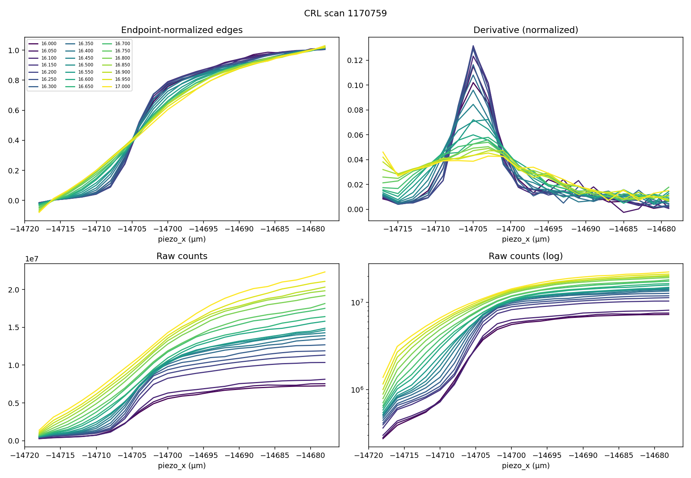
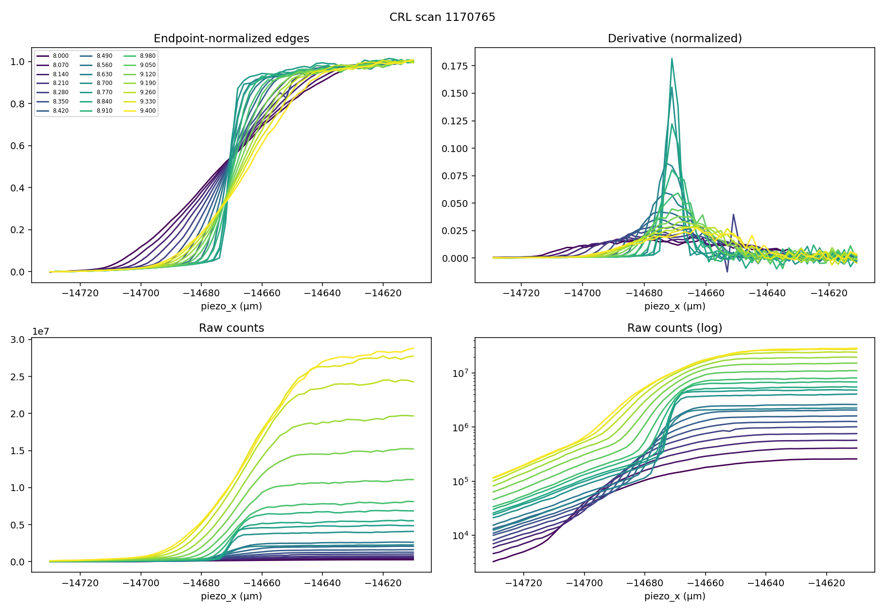
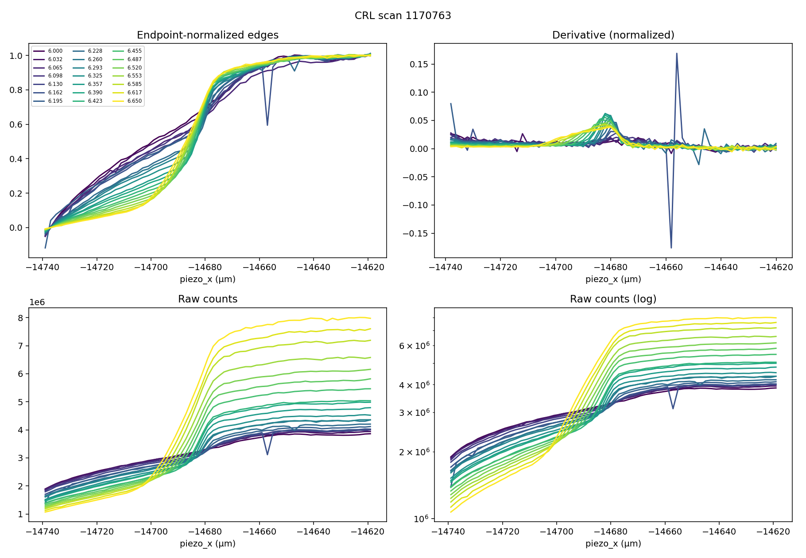
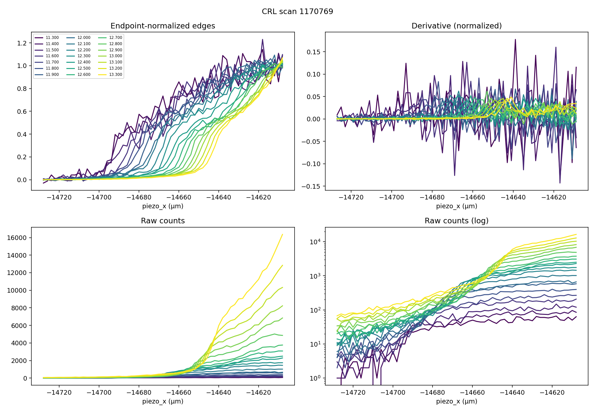

# CRL commissioning measurements — 15–16 October 2026

## Main findings

**Holders 4 and 3 demonstrably produce a narrow horizontal focus.** Holder 4
reached **4.70 µm sampled derivative FWHM at 8.77 keV**, and holder 3 at
CRL z=+200 mm reached **5.39 µm at 16.20 keV**. Both minima are bracketed
by broader measurements on either side in energy.

**The measurements support a distance near 1600 mm with the deliberately
illuminated small SSA as the secondary source.** The operator confirms that
the SSA was closed down and **mirror bending voltages were adjusted to maximize
flux through that aperture**, bringing the upstream focus onto or near the SSA.
This makes the SSA-source model the primary physical
interpretation of this dataset. Assuming nominal two-sided Be lenses and
the SSA as a secondary source 10.5 m upstream,
the two measurements imply Z=0 lens-to-edge distances of **1631 and 1557 mm**.
This supports the documented approximately **1600 mm** geometry over **1350 mm
with the same SSA-source assumption**. The two inferred distances differ by
about 74 mm, so these data do not yet give a precision common distance.
An alternative collimated-input calculation is retained below only as a model
sensitivity check; it does not incorporate the operator's SSA-alignment evidence.

**Holder 5 focuses a narrow core, but much of its profile remains broad. Holder 2
does not yield a defensible best-focus energy in the measured configuration.**
Neither observation alone establishes damaged or incorrectly labeled lenses.

- **[Illustrated PDF report](CRL_measurement_report_2026-10-16.pdf)**: eight pages of
  focus curves, energy–position maps, raw profiles, derivatives and interpretation.
- [Interactive measurement report](measurement_report.html): all four scans,
  raw edges and derivatives at every energy, partial attempts, counts, and models.
- [Per-energy numerical results](measurement_edges.csv)
- [Run inventory and measured settings](measurement_runs.csv)
- [Conditional geometry calculations](measurement_geometry.csv)
- [Distance/curvature sensitivity illustration](measurement_geometry_degeneracy.csv)

## 1. What was actually recorded

Data were read from the NSLS-II Tiled `smi/raw` catalog. The report uses recorded
scalar data, acquisition configuration, start/stop documents, and before/after
baseline readings. No hardware was moved. Times below are America/New_York
(EDT), derived from the run-start epoch; the repeated `start_datetime` metadata
field is not used as a per-run timestamp.

| Scan | Holder / nominal contents | CRL z (mm) | Start | Energy range / step (keV) | Recorded grid | Role |
|---|---|---:|---|---|---|---|
| 1170759 | 3 / 16 × R50 µm Be | +200 | Oct 15 13:27 | 16.00–17.00 / 0.050 | 21 × 21 = 441 | Original reference |
| 1170763 | 5 / 2 × R50 µm Be | 0 | Oct 15 16:19 | 6.000–6.650 / 0.0325 | 21 × 61 = 1281 | Complete new scan |
| 1170765 | 4 / 4 × R50 µm Be | 0 | Oct 15 20:37 | 8.00–9.40 / 0.070 | 21 × 61 = 1281 | Complete new scan |
| 1170769 | 2 / 8 × R50 µm Be | 0 | Oct 16 08:39 | 11.30–13.30 / 0.100 | 21 × 61 = 1281 | Complete new scan |

All four used **0.5 s exposure**, **2 µm piezo-x steps**, SSA H/V gaps
**0.030/0.0499 mm**, and SAXS detector z about **9300 mm**. The reference
edge window was 40 µm wide; the new windows were 120 µm. Sample piezo y/z
were approximately 10800/−4000 µm throughout. Energy readback differed from
setpoint by less than 0.01 eV in the cached rows; this confirms move agreement,
not absolute photon-energy calibration. Mirror voltage settings were unchanged
between these four baseline snapshots, consistent with retaining the optimized
bending settings during acquisition; this does not imply they were unchanged
during the preceding alignment.

**Operator-provided setup context:** all scans used the small SSA aperture,
and **mirror bending voltages were varied to maximize transmitted flux through it**.
This deliberately adjusts upstream focusing, rather than only centering a beam
on the aperture, and supports placing the upstream waist at or near the SSA.
This alignment procedure is additional experimental information, beyond the
recorded gap sizes. It supports treating the effective secondary source as
located at or close to the SSA. The report therefore prioritizes the documented
p₀=10.5 m SSA model. Exact wavefront curvature is not itself measured by the
gap readbacks or a flux maximum, so residual source/illumination effects remain
a systematic consideration rather than an equally weighted alternative setup.

Measured CRL x/y and insertion agree closely with the per-holder alignment
settings. **CRL angle readbacks differed between runs**: initial `crl_ph` values
were +0.023384, −0.039184, −0.020224, and −0.015168 for the four rows above;
`crl_th` also differed. Thus these are measurements of different aligned
configurations, not an identical alignment with only lens count changed.
Baseline snapshots cannot establish stability during every exposure.

### Partial attempts and coarse scans

| Scan | Recorded / planned fine points | Interpretation |
|---|---:|---|
| 1170761, holder 5 | 105 / 1281 | One complete 6.0 keV row and a partial 6.0325 keV row; latter has zero counts and recorded attenuation of order 10^181. Not a focus sweep. |
| 1170767, holder 2 | 1037 / 1281 | 17 recorded energy rows; failed during pitch-feedback recovery. The 12.9 keV row loses signal. Earlier rows corroborate the low-signal, moving-edge problem. |
| 1170771, holder 3 at z=0 | 53 / 1281 | Only part of the first 16.0 keV edge; no energy-focus minimum can be measured. |

Runs 1170761 and 1170771 have `exit_status=success` despite incomplete recorded
grids. “Success” therefore does not establish coverage. The saved live HTML
listed a holder-3 “best” at 16.0 keV/77.6 µm from that incomplete row; **that is
not a measured focus minimum**. The report retains these runs as diagnostics.

All six associated 81-point coarse scans (1170760, 62, 64, 66, 68, 70) are
cached. Their conditions are not necessarily the same as the fine scans:
holder-2 coarse scans used harmonic 11 whereas fine scans used harmonic 9;
several recorded foil selections also changed between coarse and fine runs.
Consequently a center found by a coarse scan need not remain centered in the
fine scan. The present report does not interpret a coarse scan as another
energy-focus measurement.

## 2. Analysis and measurement limits

The first width measure reproduces the earlier report: sort each energy row
by piezo x, take the **unsmoothed positive first difference**, and use the public
`smi_plans.analysis.analyze_xy(..., model="none", profile="peak", x_sigma=0)`
FWHM relative to its estimated derivative baseline. Reject a width if either
derivative endpoint is above half height. Automatic polarity flipping is not used.

This endpoint test is necessary but **not sufficient**: intensity dips, shot
noise, multiple components, and truncated tails can still produce false widths.
The CSV retains this diagnostic output, including rejected interpretations,
so that the older live results can be traced rather than silently replaced.
The report's conclusions additionally use the raw edge shape and neighboring
energies. `largest_downstep_fraction` quantifies the largest intensity decrease
relative to that row's measured count range; it is a diagnostic, not an automatic
quality acceptance threshold.

A second diagnostic fits an unweighted **Gaussian cumulative edge plus constant
background** to the complete measured window. The fitted width is 2.35482 σ;
`fit_coverage` says whether the measured window covers the fitted center ±2σ.
The RMS residual is normalized to fitted amplitude. This is not a proof of
Gaussian beam shape: disagreement with the derivative width is useful evidence
of wings/pedestal or model mismatch. No fit covariance is treated as an
experimental uncertainty. Partial rows remain explicitly marked.

The reported widths characterize the horizontal knife-edge line profile, including
finite-step averaging, edge quality/orientation, motion, and detector weighting.
They are not deconvolved optical spot sizes or vertical measurements. A 4.7 µm
width spans only about 2.4 scan steps; quoted decimals permit reproduction,
not submicron accuracy. Adjacent energy samples give a useful resolution bracket,
**not a confidence interval**. No smooth focus-curve fit is used to claim a more
precise optimum than the scan supports.

## 3. Results by holder

### Holder 3, original scan 1170759: a real narrow core at z=+200 mm

- Minimum sampled derivative width: **5.39 µm at 16.20 keV**.
- Neighboring points: 5.54 µm at 16.15 and 5.61 µm at 16.25 keV.
- Whole-edge Gaussian width at 16.20 keV: **9.27 µm**. The larger result reflects
  non-Gaussian wings; it is not a second measurement of the same core definition.
- The high-energy edge becomes clipped; derivative widths from 16.85 keV upward
  fail the half-height coverage check.
- Harmonic changes from 13 to 15 at 16.15 keV. The minimum lies just above that
  change; a locked-harmonic repeat would strengthen its use for calibration.



### Holder 4, scan 1170765: the cleanest new focus measurement

- Minimum sampled derivative width: **4.70 µm at 8.77 keV**.
- Neighboring points: 5.40 µm at 8.70 and 6.69 µm at 8.84 keV.
- Whole-edge Gaussian width at 8.77 keV: **5.03 µm**, agreeing closely with the
  derivative core width. Broadening away from focus is clear on both sides.
- Harmonic 7 is fixed. This is the strongest new evidence for successful lens
  focusing and approximate nominal power.
- An intensity dip at 8.63 keV is visible in the count-rate trend; it does not
  create the 8.77 keV width minimum.



### Holder 5, scan 1170763: narrow core plus broad pedestal

- A narrow derivative core develops around **6.26–6.36 keV**, with a local
  sampled minimum **6.38 µm at 6.325 keV** (6.62 µm at 6.2925 and 7.59 µm
  at 6.3575 keV). This is conditional evidence for focusing a beam component.
- The automatic global minimum, **1.65 µm at 6.1625 keV**, is **spurious**:
  a single intensity drop/recovery in the open-side region creates a narrow
  derivative spike. The largest down-step is about **34% of the row's count span**.
- The broad contribution is substantial: at 6.325 keV the whole-edge Gaussian
  width is **42.5 µm**, compared with the 6.38 µm core. Whole-edge fitted widths
  instead reach approximately **25–26 µm around 6.49–6.59 keV**. There is no
  metric-independent single “best focus.”
- Low-energy rows do not reach a convincing closed plateau within the window.
  The broad component could involve unfocused/parasitic light, lens illumination,
  aberration, or energy-dependent spectral contributions. The scalar data do not
  identify which, and do not justify a precise pedestal fraction.



### Holder 2, scan 1170769: inconclusive focus, clear measurement problems

- The whole-edge fit center moves about **50 µm** across 11.3–13.3 keV.
  This is a diagnostic of a moving/reshaping profile, not a calibrated centroid.
- Low-energy open-side readings are only about **58 counts/frame**; by 13.3 keV
  they reach about **15,300 counts/frame**, but the scan ends on a rising tail.
- The live derivative minimum **34.70 µm at 12.8 keV** lacks reliable whole-edge
  coverage and a clean bracketed focus trend. **Do not use 12.8 keV to infer
  lens distance or power.**
- Gaussian diagnostic widths are broad (roughly 40–60 µm for most rows), with
  significant shape mismatch and clipping. The failed earlier attempt 1170767
  shows a similar problem before its signal loss.
- These data show that this configuration did not deliver a demonstrated narrow
  focus. They do not distinguish lens misalignment, illumination/beam steering,
  wrong nominal contents, or lens damage.



## 4. What this says about the CRL documentation

Comparison source: `profile_collection/docs/CRL_MICROFOCUSING.md` and the
hardware-independent `src/smi_beamline/devices/crl_optics.py` model. That model
assumes common-plane, two-sided Be lenses, E⁻² refractive power, and a signed
incident curvature propagated with Z.

For assumed nominal lens power P(E), source distance p₀=10.5 m, and measured Z:

```text
P(E_focus) = 1 / (d0 - Z) + 1 / (p0 + Z)      [all distances in metres]
d0 = Z + 1 / [P(E_focus) - 1/(p0 + Z)]
```

### Model predictions versus the two reliable focus observations

| Holder / Z | Observed energy (keV) | 1600 mm + SSA | 1350 mm + SSA | 1600 mm + collimated | 1350 mm + collimated |
|---|---:|---:|---:|---:|---:|
| 3 / +200 mm | 16.20 | 16.426 | 15.044 | 17.468 | 15.832 |
| 4 / 0 mm | 8.77 | 8.698 | 8.073 | 9.337 | 8.577 |

With the accepted **1600 mm + SSA** model, the observed focus energies differ
by **−1.38% (holder 3)** and **+0.83% (holder 4)**. If distance and curvature
are fixed, these correspond to effective lens-power scale factors **0.973 and
1.017** relative to nominal. That is consistent with the labeled strengths at
the few-percent level, subject to the model and measurement systematics; it
does not establish exact element counts, material, or radii individually.

The small SSA also supplies a useful **spot-size scale**. At the 1600 mm geometry,
imaging a fully illuminated 30 µm horizontal aperture gives a geometrical image
extent of about **30 × 1.6/10.5 = 4.57 µm at z=0**, or
**30 × 1.4/10.7 = 3.93 µm at z=+200 mm**. The measured 4.70 and 5.39 µm core
widths are on this few-micron scale, which is qualitatively consistent with
SSA imaging. This is an aperture-image estimate, not a Gaussian FWHM prediction:
illumination of the aperture, diffraction, wings, and 2 µm sampling prevent
using it to deconvolve a lens-resolution contribution. A waist smaller than
the aperture would change the effective source width.

With nominal powers and **SSA curvature fixed**, inferred distances are:

| Holder | Inferred d0 | Using the adjacent sampled energies |
|---|---:|---:|
| 3 | 1557 mm | 1547–1566 mm for 16.15–16.25 keV |
| 4 | 1631 mm | 1601–1661 mm for 8.70–8.84 keV |

The approximately **74 mm disagreement** between the central inferred distances
is larger than their adjacent-sample brackets overlap (they do not overlap).
Do not average these into a precision distance calibration. Holder principal
planes, actual radii, wavefront curvature, alignment, the reference harmonic
switch, and width definition can all matter.

The holder-5 **core-only** 6.325 keV estimate would imply **1707 mm** under the
same SSA assumption, or about **1.058× nominal power** at 1600 mm. The broad
pedestal and conflicting optimum from whole-edge fitting make this a conditional
diagnostic, not a third equally weighted distance measurement.

### SSA-source interpretation and a curvature sensitivity check

The small-aperture, flux-maximized setup supports the SSA as the effective
secondary source. On that experimental basis, the main inference is **d0 near
1.6 m**, with the holder-to-holder discrepancy requiring further investigation.
It is more useful to test effective lens strength, holder principal-plane
offsets, alignment, and focus-metric systematics than to treat a collimated beam
as equally supported by this commissioning setup.

For sensitivity only: if the input were collimated, the same two reliable measurements imply d0≈**1404
and 1412 mm**. Allowing both a common distance and incident curvature to vary
fits the two central energy observations exactly at approximately **1384 mm**
and **C₀=−0.0142 m⁻¹** (weakly converging). This is a two-equation/two-unknown
illustration with **zero degrees of freedom**, additionally assuming exact nominal
holder powers and common principal plane. It is **not** a validated alternative
geometry. `measurement_geometry_degeneracy.csv` repeats it for neighboring
energy samples to expose its sensitivity.

This mathematical degeneracy explains why focus energies alone are insufficient
to measure both distance and curvature. It does not supersede the known
small-SSA alignment or the independent 3D-model geometry. Together, that setup
information and the focus measurements support the **1600 mm + SSA** model as
the working interpretation, without claiming that the exact source curvature
has been measured.

### Status of outstanding documentation questions

| Question | What these data establish |
|---|---|
| Do labeled CRLs actually focus? | Yes for holders 3 and 4 in the horizontal direction; holder 5 focuses a core. |
| Is 1600 mm plausible? | Yes with the SSA-source model; 1350 mm + that same model is substantially displaced from both clean minima. |
| Is the SSA the appropriate effective-source assumption? | Yes as the working model: mirror bending was optimized for flux through the 30 × 49.9 µm aperture, placing the upstream focus near the SSA. Exact curvature is not independently determined by these focus scans. |
| Are nominal Be strengths approximately right? | Holders 3 and 4 agree at a few-percent effective-power level conditional on 1600 mm + SSA. |
| Is holder 2 defective? | Not established; this alignment/data quality is insufficient for that conclusion. |
| Are blank holders diamond, and what are their radii/counts? | Not tested. |
| Are vertical focusing, transmission, and all energy bands verified? | No vertical scan, lens-out flux reference, or coverage survey was taken here. |

## 5. Intensity and recorded acquisition differences

Use the final-three-position mean divided by exposure only as a **finite-window
detector count rate**, not calibrated flux or lens transmission. There is no
per-point incident monitor in these primary streams. Baseline ring current is
near 500 mA, but it does not normalize energy-dependent source intensity or
feedback fluctuations. No dark subtraction, absorption correction, or detector
efficiency correction has been applied.

The new complete scans actually recorded:

| Holder | Fixed foil | Recorded attenuation across energy window | Final-three mean counts/frame |
|---|---|---:|---:|
| 5 | 30 µm Sn | 100,675 → 6,824 | 3.85M → 8.00M |
| 4 | 80 µm Mo | 251,827 → 2,989 | 0.259M → 28.57M |
| 2 | 240 µm Sn | 21,977,905 → 47,840 | 58 → 15,322 |

These are **recorded model attenuation factors**, not independently measured
transmissions. The holder-2 window is far more attenuated than the nominal
1500× minimum; the plan's optimistic dim-end count estimate was not achieved.
Counts also exceed the earlier README's estimated 7M bright-end level in other
scans. Total counts alone do not establish pixel saturation or detector linearity;
image-level checks would be needed. Multiplying total counts by the fundamental
attenuation factor would not safely remove spectral/pedestal contributions.

The fine-scan start metadata says Pilatus sensitivity was fixed at each holder's
model energy. However, the cached primary field lists **do not contain the
advertised energy/threshold/gain readbacks**. Thus this report records that policy
as metadata intent, not verified per-frame sensitivity. This discrepancy and
the coarse/fine harmonic/foil changes should inform the next acquisition revision.

## 6. Most informative next measurements

1. **Refine the SSA-based distance and lens checks:** use the clean holder 4 at several
   well-separated Z positions with a locked harmonic, fixed alignment and foil,
   and narrower energy steps near each minimum. Include both sides of every
   minimum. A same-holder Z series reduces cross-holder power/principal-plane
   ambiguity; an independent mechanical distance check further tests the residual
   discrepancy. Keep the same small-SSA, flux-maximized illumination.
2. **Resolve holder 2:** obtain a wider coarse edge in the *same harmonic and
   attenuation state* as the fine sweep, improve counting statistics based on
   observed counts, and track/recenter the edge across energy. Check insertion
   and angular alignment before interpreting widths as lens performance.
3. **Understand holder 5's pedestal:** inspect representative detector images
   and compare lens-in/lens-out and alignment/energy dependence. Use a wider
   edge scan to measure both plateaus; distinguish core width from whole-beam
   concentration rather than reporting a single automatic minimum.
4. Add vertical knife edges and a same-energy lens-out/monitor reference if
   the next questions are astigmatism, transmission, or lens health.

## Reproduce

From the sibling `smi-plans` checkout:

```bash
# Offline rebuild from the saved scalar cache; no Tiled login needed.
.pixi/envs/default/bin/python ../SWAXS_user_scripts/Commissioning/2026-10-15_crl_energy_focus/measurement_report.py

# Read missing runs from Tiled. Existing cache entries are reused.
.pixi/envs/default/bin/python ../SWAXS_user_scripts/Commissioning/2026-10-15_crl_energy_focus/measurement_report.py --fetch --profile smi

# Optional static diagnostic panels (requires matplotlib; workstation Python has it).
PYTHONPATH=src python ../SWAXS_user_scripts/Commissioning/2026-10-15_crl_energy_focus/measurement_report.py --plots

# Offline coverage, width-method and numerical-result checks.
.pixi/envs/default/bin/python -m pytest -q ../SWAXS_user_scripts/Commissioning/2026-10-15_crl_energy_focus/test_measurement_report.py

# Illustrated PDF (workstation Python includes Matplotlib).
python ../SWAXS_user_scripts/Commissioning/2026-10-15_crl_energy_focus/make_measurement_pdf.py
```

`measurement_cache/` contains primary scalar CSVs, complete baseline scalar
CSVs, selected configuration values, start/stop metadata and full UIDs for
all 13 runs. Image arrays are not downloaded. The interactive HTML embeds Bokeh
resources and works offline. The analysis imports only the hardware-independent
CRL model, not the beamline startup or acquisition plans. The report is an
interpretation of this dated dataset, not a change to the operational model.
